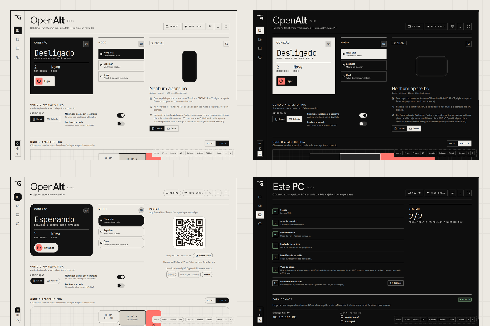

<p align="center"></p>

<h1 align="center">OpenAlt</h1>

<p align="center"><b>Empowering anyone to stream anywhere.</b></p>

<p align="center">Turn your Android phone or tablet into a second monitor, a mirror of your PC, or a game screen. At home or away. Scan one QR code and you're in.</p>

<p align="center"><a href="https://cattastudios.com.br/openalt-releases/"><b>Website</b></a> · <a href="https://github.com/berelels/openalt-releases/releases/latest"><b>Latest release</b></a> · <a href="#source-code"><b>Source code</b></a></p>

<p align="center"></p>

This is where OpenAlt is **published**: the downloads, the website and the source code of every version. OpenAlt is **free and open source** (GPL-3.0). No account, no subscription, no servers of ours: your PC streams straight to your device.

> [!WARNING]
> **Early preview.** OpenAlt has been tested on very few machines so far. Read [Known issues](#known-issues) before you try it, and expect rough edges.

<p align="center"></p>

## What it does

- **New screen:** your device becomes a real extra monitor at its own resolution, right, left, above or below any of your monitors.
- **Mirror:** shows any one of your monitors on the device.
- **Pair by QR code:** a one-time code that expires quickly. No IP addresses, no PINs.
- **Away from home:** mirrors your PC over 4G or any Wi-Fi through your own [Tailscale](https://tailscale.com) account.
- **Games:** a console-style Android app with controller support, built on [Moonlight](https://github.com/moonlight-stream/moonlight-android). The PC side uses [Sunshine](https://github.com/LizardByte/Sunshine).

Languages: English, Portuguese and Spanish in both apps.

## Download

From the [latest release](https://github.com/berelels/openalt-releases/releases/latest):

| | File |
|---|---|
| PC, any Linux (GNOME on X11) | [`openalt-0.1.2-x86_64.AppImage`](https://github.com/berelels/openalt-releases/releases/download/v0.1.2/openalt-0.1.2-x86_64.AppImage) |
| PC, Ubuntu / Debian / Zorin / Pop!_OS | [`openalt-0.1.2-amd64.deb`](https://github.com/berelels/openalt-releases/releases/download/v0.1.2/openalt-0.1.2-amd64.deb) |
| Android 5+ (phone or tablet) | [`openalt-0.1.2.apk`](https://github.com/berelels/openalt-releases/releases/download/v0.1.2/openalt-0.1.2.apk) |

Checksums are in `SHA256SUMS.txt` on each release page.

## Install

**PC** (Linux with GNOME on **X11**; Wayland is not supported yet)

- **AppImage** (any distro): make it executable and run it.
  ```bash
  chmod +x openalt-*-x86_64.AppImage
  ./openalt-*-x86_64.AppImage
  ```
  Then, in **This PC**, press **Install** next to *System permission* once (it asks for your password).
- **.deb** (Ubuntu, Debian, Zorin, Pop!_OS): this also installs the system helper.
  ```bash
  sudo apt install ./openalt-*-amd64.deb
  ```
- You also need [Sunshine](https://github.com/LizardByte/Sunshine). On first run the app can install the Flatpak for you.
- For away from home: [Tailscale](https://tailscale.com/download) on the PC and on the device.

**Android** (5 or newer)

- Download the `.apk` on the device and open it. Android asks once to allow installing apps from your browser or file manager.
- Every APK is signed with the same key, so a new version installs over the old one. SHA-256 of the signing certificate:
  `03:11:C2:CA:67:A6:20:8E:0F:35:B4:53:6E:D2:87:D3:DA:4A:1B:04:E2:35:A5:3C:C5:57:D3:82:DD:36:33:10`

**Then:** open OpenAlt on the PC, press **Turn on**, and scan the QR code with the app on your device.

From version 0.1.2 on, both apps tell you when a newer version is published here. They only read the list of releases: nothing is downloaded or installed on its own, and nothing about you is sent.

## Known issues

- **The mouse can stay stuck on the second monitor** after a New screen session.
- **Duplicated cursor at the screen edge** in some cases. This comes from Sunshine's X11 capture.
- **Video in Chromium-based browsers** (Chrome, Brave) can freeze on the virtual screen.
- **No wallpaper on the new screen right after connecting.** Restart GNOME with Alt+F2, `r`, Enter (your programs stay open). The app shows this tip on the device card.
- **AMD graphics cards stream in H.264 only.** HEVC through VAAPI leaves green bars when mirroring ([Sunshine#4314](https://github.com/LizardByte/Sunshine/issues/4314)).
- **Away from home is mirror only**, by design.
- **Without the system helper installed**, disconnecting leaves the device's video output reserved until you press *Turn off*, and *Turn off* asks for your password.
- **Button mapping** may not apply on controllers that Moonlight already remaps internally.

**What has and hasn't been tested**

| | Status |
|---|---|
| Zorin OS 18 (GNOME 46, X11), AMD RX 6600, two monitors | tested |
| Galaxy S20 FE (phone) and Galaxy Tab S6 Lite (tablet) | tested |
| Away from home over 4G with Tailscale | tested |
| Xbox and PlayStation controllers through the phone | tested |
| Other GNOME X11 distros | expected to work, untested |
| Intel graphics | untested |
| NVIDIA proprietary driver | **likely not working yet** |
| Hybrid laptops, USB-C docks with several monitors | untested |
| KDE, XFCE, Cinnamon | Mirror should work; New screen does not yet |
| **Wayland** | **not supported yet** |
| Windows, macOS, iOS | not supported |

Found a problem? Please [open an issue](https://github.com/berelels/openalt-releases/issues).

## Source code

OpenAlt is licensed under the GNU GPL v3.0 or later. Every release here has the **complete source code of that version** attached as `openalt-<version>-source.tar.gz`, including the Moonlight libraries it builds on. The build instructions are in the `README.md` inside it.

## Credits and license

Made by [Gabriel Dias](https://github.com/berelels) at **[Catta Studios](https://cattastudios.com.br/)**.

OpenAlt is built on [Sunshine](https://github.com/LizardByte/Sunshine), [Moonlight Android](https://github.com/moonlight-stream/moonlight-android), [moonlight-common-c](https://github.com/moonlight-stream/moonlight-common-c) and [Tailscale](https://tailscale.com). The full list of third-party software and licenses is in [THIRD-PARTY.md](THIRD-PARTY.md).

License: [GPL-3.0-or-later](LICENSE).
